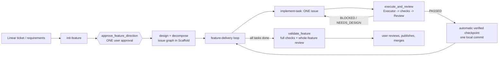

# Pi delivery pipeline: component map

**Status: draft, derived from reading the code.** Items marked *(unverified)* were
inferred, not traced. [`../workflow-overview.md`](../workflow-overview.md) describes
the *process*; this file describes the *parts*, where state lives, and what guards what.
[`agent/lib/README.md`](agent/lib/README.md) describes library boundaries in more depth.

## 1. What the system is for

Pi (an LLM agent) implements a feature in small tasks, unattended, on a feature branch.
The system exists so that a human can trust the result without watching. It does that by
enforcing one invariant:

> **Every commit between the feature's baseline and HEAD is an authenticated checkpoint
> of one task that passed its checks and an independent review, under a feature direction
> the user approved.**

Almost everything below either *produces* the evidence for that invariant, *checks* it, or
*recovers* when real life breaks it (rebases, interruptions, extra commits).

## 2. Actors

| Actor | What it is | Owns | Trust |
|---|---|---|---|
| **User** | A human | The one direction approval; adoption approval; merging/publishing | Source of authority. Only a real UI confirmation counts. |
| **Pi** | The LLM orchestrator, driven by `SYSTEM.md` and skills | Reasoning, designs, choosing the next task | **Not trusted.** Cannot edit source directly; only native tools apply changes. |
| **Scaffold** | External CLI/state store (`.scaffold/tasks.json`, gitignored) | Feature + issue graph, designs, task status, `original_baseline`, `workflow.instance_id`, delivery journal | Validates structure and association, **not** evidence authenticity. |
| **Conductor** | External generic command runner | Runs a list of commands with conditions | Neutral runner. |
| **Executor** | External CLI | Applies a set of file operations | Makes the edits. |
| **Review** | External independent reviewer (separate model) | Approves or rejects a diff against the requirements | Independent judge. |
| **Linear** | Ticket system | Ticket source | Input only. |

## 3. Stages, skills and tools



Note the order: direction approval happens **before** the issue graph is designed. The
approved "direction" is the feature-level design context, objective, criteria and
constraints. Issue designs are produced afterwards, inside that approved scope.

| Stage | Skill | Native tool(s) | Code |
|---|---|---|---|
| Prepare feature | `init-feature`, `design` | `scaffold_tasks`, `write_plan`, `linear_*` | `extensions/scaffold`, `extensions/plan`, `extensions/linear` |
| Approve direction | (in `init-feature`) | `approve_feature_direction` | `lib/authorization/feature.mjs` |
| Orchestrate | `feature-delivery` | none of its own | skill text |
| One task | `implement-task`, `executor` | `execute_and_review` | `extensions/execute-and-review` |
| Checkpoint | (automatic) | `checkpoint_verified_task` (recovery only) | `extensions/checkpoint` |
| Final gate | `feature-delivery` | `validate_feature` | `extensions/feature-validation` |
| Standalone review | `review` | `review_changes` | `extensions/review` |

### Every registered tool

| Tool | Extension | Purpose | Mutates |
|---|---|---|---|
| `scaffold_tasks` | scaffold | Scoped read/write of the task graph | Scaffold state |
| `approve_feature_direction` | execute-and-review | The one direction approval | evidence |
| `approve_delivery_amendment` | execute-and-review | Approve a material contract change | evidence + Scaffold |
| `execute_and_review` | execute-and-review | One Executor, checks, Review pass; auto-completes and checkpoints on PASS | source, evidence, Scaffold, Git |
| `checkpoint_verified_task` | checkpoint | Create or recover the checkpoint commit for a passed task | Git |
| `validate_feature` | feature-validation | Final full checks + whole-feature review | evidence, Scaffold |
| `inspect_conductor_evidence`, `inspect_feature_validation`, `inspect_rebase_evidence`, `inspect_issue_handoff`, `inspect_issue_attempt` | various | Read retained evidence and handoffs | none |
| `suspend_issue`, `resume_issue` | execution-recovery | Park an unfinished issue (saved source/index) and return the graph to design; restore it later | Scaffold, refs, evidence |
| `prepare_issue_handoff` | execution-recovery | Save scoped context for a fresh session | evidence |
| `reconcile_feature_rebase` | execution-recovery | Re-verify the completed prefix after a rebase between tasks | evidence, refs |
| `recover_interrupted_task_rebase` | execution-recovery | Carry an unfinished task across a rebase | evidence, refs |
| `adopt_feature_baseline` | execution-recovery | Adopt a user-approved baseline before any task starts (PR #87) | evidence, refs |
| `inspect_feature_drift` | execution-recovery | Read-only: classify Git drift, name the recovery (PR #87) | none |
| `review_changes` | review | Standalone review | none |
| `write_plan`, `write_ticket_file` | plan | Write planning documents | files |
| `linear_*` (4) | linear | Ticket API | Linear |

Also in the repo but unrelated to delivery: the `lsp` and `conductor` (`/conductor` command)
extensions, and the `comfyui-generate` skill.

## 4. Where state lives (the part that is hardest to reason about)

Truth is split across four stores. Operations re-read and cross-check them.

| Store | Location | Holds | Written by |
|---|---|---|---|
| **Scaffold state** | `.scaffold/tasks.json` (gitignored; must stay untracked) | Feature, issue graph, designs, task status and history, `original_baseline`, `instance_id`, delivery journal (`begun`/`finished`/`initialized`/`context`/`handoff` entries) | Scaffold CLI via `scaffold_tasks` |
| **Evidence files** | `.git/pi-conductor-evidence/` (per checkout) | Content-addressed JSON. `<hash>.json` = task receipts (`pi.task-attempt/v1`); `feature-<hash>.json` = feature records | `lib/evidence/store.mjs` |
| **Git refs** | `refs/pi-*` | Keeps objects alive and anchors records | see below |
| **Commit trailers** | on checkpoint commits | `Pi-Task-Checkpoint: {...}` binds feature, design, branch, `featureBaseRef`, parent, tree, receipt (and `adoptionRef`) | `extensions/checkpoint/commit.mjs` |

Evidence records:

| Record | Store file | Written by |
|---|---|---|
| Task attempt receipts (incl. `issue-suspension`, `issue-zero-handoff`, `issue-handoff`, `rebase-handoff`) | `<hash>.json` | execute-and-review, execution-recovery |
| `feature-authorization` | `feature-<hash>.json` | `lib/authorization/feature.mjs` |
| `delivery-amendment` | `feature-<hash>.json` | `context-amendment.mjs` |
| `reconciliation` | `feature-<hash>.json` | `execution-recovery/reconciliation.mjs` |
| `baseline-adoption` | `feature-<hash>.json` | `lib/verification/baseline-adoption.mjs` |
| Feature validation (`pi.feature-validation/v1`) | `feature-<hash>.json` | `extensions/feature-validation` |

Git ref families:

| Ref prefix | Purpose | Written by |
|---|---|---|
| `refs/pi-checkpoints/` | Pending checkpoint commit and index while committing | checkpoint |
| `refs/pi-delivery-journals/` | Audit anchor for a task's delivery journal | delivery-state |
| `refs/pi-issue-suspensions/` | Saved source and index when an issue is parked | execution-recovery |
| `refs/pi-task-recoveries/` | Audit snapshots across task recovery | execution-recovery |
| `refs/pi-reconciliations/` | Before and after heads of a rebase reconciliation | execution-recovery |
| `refs/pi-baseline-adoptions/` | Authoritative adoption record + original/adopted commits | baseline-adoption |

## 5. Code layers

```
skills/ + SYSTEM.md          guidance for Pi (text; no enforcement)
extensions/*/index.ts        tool registration + user-facing confirmations
extensions/*/*.mjs           workflows: coordinate, perform lifecycle writes
lib/verification             authenticate evidence, chains, checkpoints (pure checks)
lib/authorization            feature/amendment authority
lib/evidence, git, ...       storage, Git snapshots, contracts
external: Scaffold, Conductor, Executor, Review
```

Rule (from `lib/README.md`): **`lib` never imports from `extensions`.** Coordinators fetch fresh
Scaffold data and pass it in; libraries validate it.

## 6. Where the invariant is enforced

`checkpointHistory()` (`lib/verification/checkpoint-history.mjs`) walks HEAD back to the
baseline and requires each commit to be an authentic checkpoint matching a completed task
and its receipt. It is called from:

`issue-scope` (before executing a task), `attempt-chain` (continuations), `checkpoint/commit.mjs`
(creating a checkpoint), `feature-validation` (final gate), `lib/verification/reconciliation.mjs`
and `execution-recovery/reconciliation.mjs` (rebase), `issue-recovery`, and `drift.mjs`.

Any new situation in which history legitimately contains something that is not a checkpoint
needs its own accommodation here. That is the source of most special cases.

## 7. Authority

| Grant | Granted by | Lasts | Covers |
|---|---|---|---|
| Feature direction | `approve_feature_direction` (UI confirm) | Persisted evidence; exact-scope match | The whole local loop: design, implementation, checks, review, checkpoints, recovery. **Not** publish or merge. |
| Delivery amendment | `approve_delivery_amendment` | Per change | One concrete contract change |
| Baseline adoption | `adopt_feature_baseline` (UI confirm) | Persisted | One named old to new baseline move |
| Checkpoint grant | per-session UI grant (`checkpointAuthorization`) | Session | Local commits; separate from feature direction |

## 8. Recovery: which tool, when

| Situation | Use |
|---|---|
| Not sure | `inspect_feature_drift` |
| Clean user commit before any task started | `adopt_feature_baseline` |
| History rewritten between tasks | `reconcile_feature_rebase` |
| Rebase interrupted mid-task | `recover_interrupted_task_rebase` |
| A task failed or was interrupted | continue with `previousAttempt` / issue handoff |
| Checkpoint commit lost or interrupted | repeat `checkpoint_verified_task` |
| Need to park an issue and return to design | `suspend_issue`, then `resume_issue` |
| Never | edit Scaffold or evidence by hand; run `scaffold clean`; reapprove to reset history |

## 9. Glossary

- **Original baseline**: commit the feature branched from; recorded in Scaffold; immutable.
- **Execution baseline**: where checkpoints begin. Equals the original baseline unless adopted.
- **Instance id**: `workflow.instance_id`; distinguishes a recreated feature from the original.
- **Receipt**: content-addressed evidence of one task attempt (checks + review).
- **Checkpoint**: the local commit produced for a passed task, carrying provenance in a trailer.
- **Anchor**: a verified point that lets history checks start later than the baseline (rebase reconciliation).
- **Adoption**: user-approved move of the execution baseline over unverified commits. They stay in review scope.
- **Handoff / suspension**: saved context or source so work can resume in a fresh session or after a design change.
- **Reconciliation**: verification-only recovery after a rebase.

## 10. Known gaps in this map

- *(unverified)* Whether Scaffold requires its own human approval at the design-to-implement transition.
- *(unverified)* Full list of call sites that enforce feature authorization; the ones found are
  `execute_and_review`, context amendments, checkpoint recovery and the recovery tools.
- Not traced: the internals of Scaffold, Conductor, Executor and Review (external programs).
- The delivery-state journal (`lib/delivery-state`) is only summarized.
